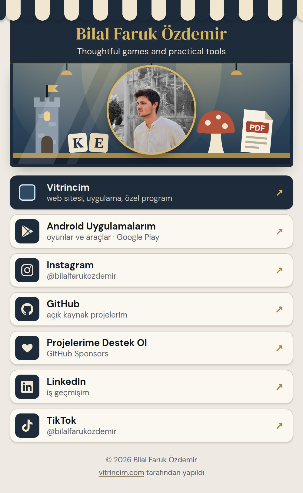
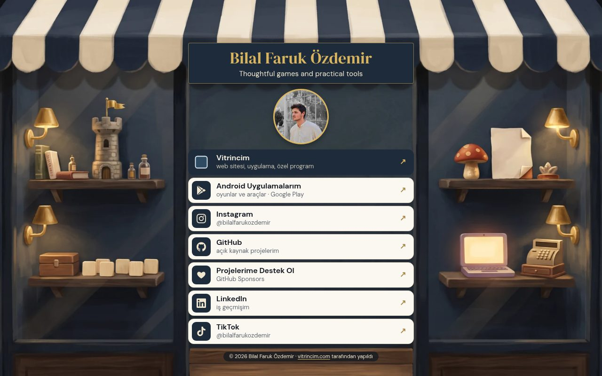

# linklerim

Linktree yerine geçen kişisel link sayfası. Saf HTML + CSS, build step yok,
runtime bağımlılığı sıfır. **Toplam maliyet: $0** (alan adı hariç).

Sayfa ve fonksiyonlar **Vercel**'de barınır; link başına tık sayacı
**Cloudflare D1**'de tutulur ve oraya HTTP API üzerinden yazılır. İkisi de
ücretsiz katman — kurulum için iki hesap gerekiyor, ikisi de bedava.
Nedenini merak edersen: [§10](#10-neden-cloudflare-pages-değil).

Linktree Pro'nun görünen tarafı burada bedava: link başına tık sayısı,
kendi alan adı, özelleştirilebilir görünüm, doğru paylaşım önizlemesi.

Canlı: <https://link.vitrincim.com>

<p align="center">
  
</p>

<p align="center"><sub>Açık tema, telefon görünümü. Koyu tema
<code>prefers-color-scheme</code> ile otomatik değişir.</sub></p>

<p align="center">
  
</p>

<p align="center"><sub>Raftaki nesnelerin üstüne gelince o işin önizlemesi açılır.</sub></p>

```
linklerim/
├── public/               ← yayınlanan dizin
│   ├── index.html        ← sayfa (CSS gömülü, harici font/JS/CDN yok)
│   ├── sahne/            ← tam sayfa arka planlar: masaustu.webp, telefon.webp
│   ├── onizleme/         ← raftaki nesnelerin üstünde açılan önizleme fotoğrafları
│   ├── fonts/            ← DM Serif Display, DM Sans (yerel kopya, OFL lisanslı)
│   ├── links.json        ← CMS'in. Tek düzenlediğin dosya.
│   ├── avatar.jpg        ← profil fotoğrafı
│   ├── icons/            ← link ikonları (yerel kopya, dışarıya istek yok)
│   ├── og.png            ← paylaşım görseli, 1200×630, statik
│   └── 404.html
├── api/                  ← Vercel Edge Function'ları
│   ├── go/[slug].js      ← /go/<slug> → 302 + tık sayacı
│   └── stats.js          ← /stats → parola korumalı istatistik sayfası
├── lib/                  ← ortak mantık (test edilebilir olsun diye ayrı)
│   ├── bots.js           ← bot / önizleme / prefetch filtresi
│   ├── links.js          ← links.json okuma + doğrulama
│   ├── go.js             ← yönlendirme + tık kaydı
│   ├── d1.js             ← Cloudflare D1'e HTTP API istemcisi
│   └── stats.js          ← parola kontrolü + istatistik HTML'i
├── tests/                ← node --test, bağımlılık yok
├── docs/                 ← README görselleri (siteye dahil değil)
├── vercel.json           ← rewrite'lar, güvenlik başlıkları, cache
├── wrangler.toml         ← sadece D1 komut satırı işleri için
├── links.example.json    ← fork edenler için şablon
└── schema.sql            ← D1 tabloları
```

---

## 0. Bu repoyu forkladıysan

Kod herkese açık, veri de öyle — çünkü bu sayfanın işi zaten o veriyi
yayınlamak. Kendine uyarlamak için değiştirmen gereken **6 şey**:

| # | Dosya | Ne yapacaksın |
|---|---|---|
| 1 | `public/links.json` | [`links.example.json`](links.example.json) içeriğini üzerine kopyala, kendi adın/bio/linklerinle doldur |
| 2 | `public/avatar.jpg` | Kendi fotoğrafınla değiştir (kare, ~400×400). İstemiyorsan sil ve `links.json`'da `"avatar": ""` yap — baş harflerin çizilir |
| 3 | `public/icons/` | İçindekileri sil. Kendi linklerinin ikonlarını istiyorsan aşağıya bak; istemiyorsan `links.json`'dan `icon` alanlarını çıkar, emoji'ler devreye girer |
| 4 | `public/index.html` | Baştaki meta bloğu: `<title>`, `og:*`, `twitter:*` ve `canonical`. İçinde `link.vitrincim.com` geçen 4 adresi kendi alan adınla değiştir |
| 5 | `public/og.png` | 1200×630 kendi paylaşım görselin |
| 6 | `wrangler.toml` | Kendi D1 veritabanının UUID'si (`npx wrangler d1 list` ile öğrenilir) |

Bunlar dışında hiçbir yerde kişisel veri yok. Parolalar ve API token'ları
repoda değil, Vercel'in ortam değişkenlerinde.

**Sahne:** `public/sahne/masaustu.webp` en az 1100px genişlik ve 3:2 oranda,
`public/sahne/telefon.webp` diğer ekranlarda pencereyi kaplar. İkisi de yapay
zekâ ile üretildi; kendi sahneni koyacaksan masaüstünde orta sütunu (yatayda
%31–69) boş bırak, önemli nesneleri yatayda %8–31 ve %69–92, dikeyde %75'in
üstünde tut, dışı bazı ekranlarda kırpılır. Telefonda fotoğrafın iki yanı
(dikeyde %13–32) ve kartların altı (%85'ten sonrası) görünür kalır.

**Link ikonları:** sayfadaki ikonlar tek renk SVG'dir, koyu kutuyu CSS çizer;
aynı görünüm için `public/icons/github.svg` örnek alınabilir. Marka ikonlarının
yolları [Simple Icons](https://simpleicons.org)'tan (CC0). Renkli favicon da
çalışır: sitenin kendi favicon'unu indirip `public/icons/`
içine koy — `https://site.com/apple-touch-icon.png` veya
`https://site.com/favicon.ico` çoğunda çalışır. PNG'ye çevir (dosya uzantısı
ile gerçek format uyuşmazsa `nosniff` başlığı yüzünden tarayıcı çizmez),
`links.json`'da `"icon": "/icons/adi.png"` yaz.

Google'ın favicon servisi gibi bir üçüncü partiye **bağlanmıyoruz**: hem
harici bağımlılık olurdu hem de sayfanı açan herkesin IP'si o servise
düşerdi. İkonlar yerel dosya.

---

## 1. Vercel'e bağlama

1. Klasörü bir GitHub reposuna at, sonra:

   ```bash
   npx vercel link --yes --project linklerim
   ```

   Bu komut projeyi oluşturur ve GitHub reposunu bağlar. Bundan sonra `main`
   dalına atılan her commit otomatik deploy olur.

2. Build ayarı yok. `vercel.json` gerekli her şeyi söylüyor:
   - `outputDirectory: public` — yayınlanan dizin
   - `rewrites` — `/go/:slug` ve `/stats` adreslerini `api/` altındaki
     fonksiyonlara bağlar
   - `headers` — güvenlik başlıkları ve cache kuralları

3. İlk yayın:

   ```bash
   npx vercel --prod
   ```

---

## 2. Tık sayacı (Cloudflare D1)

Sayaç Cloudflare D1'de duruyor ve oraya HTTP API üzerinden yazılıyor.
Vercel'in ücretsiz katmanında yerleşik bir veritabanı yok; alternatifler
(Upstash, Neon) ayrı birer üçüncü parti hesap demek. D1'in ücretsiz katmanı
bu iş için fazlasıyla yeterli.

**a) Veritabanını oluştur**

Cloudflare dashboard → **Storage & Databases** → **D1** → **Create**
→ ad: `linklerim-clicks`. Sonra `wrangler.toml` içindeki `database_id`
alanına UUID'yi yaz.

**b) Tabloları kur**

```bash
npx wrangler d1 execute linklerim-clicks --remote --file=schema.sql
```

**c) API token'ı üret**

Cloudflare → profil menüsü → **API Tokens** → **Create Custom Token**:

| Alan | Değer |
|---|---|
| Permissions | Account → **D1** → **Edit** |
| Account Resources | Include → kendi hesabın |

**d) Vercel'e üç değişkeni tanıt**

```bash
npx vercel env add CF_ACCOUNT_ID production
npx vercel env add CF_DATABASE_ID production
npx vercel env add CF_API_TOKEN production
```

Sırasıyla: Cloudflare hesap ID'si, D1 veritabanı UUID'si, üstteki token.
Ekledikten sonra yeniden deploy et — ortam değişkenleri yalnızca yeni
deployment'lara işler.

> Üçünden biri eksikse site yine çalışır: linkler yönlenir, sadece sayaç
> yazmaz. Sayaç hiçbir zaman yönlendirmeyi bloklamaz.

---

## 3. /stats parolası

```bash
npx vercel env add STATS_PASSWORD production
```

Komut parolayı soracak, yaz ve enter'la. Sonra yeniden deploy et.

Artık `https://siten/stats` tarayıcıda parola kutusu çıkarır (kullanıcı adı
serbest, sadece parola önemli). Terminalden:

```bash
curl -u :PAROLA https://siten/stats
```

Tanımlı değilse `/stats` 503 döner — açıkta kalmaz.

---

## 4. Web Analytics (ücretsiz, çerezsiz)

Vercel → proje → **Analytics** sekmesi → **Enable**.

`index.html` içindeki script zaten hazır. Script **kendi alan adından**
(`/_vercel/insights/script.js`) geliyor, yani harici bağımlılık bile değil —
CSP'de tek bir dış kaynağa izin vermek gerekmiyor. Çerez yok, kişisel veri
yok, GDPR banner'ı gerekmez.

---

## 5. Kendi alan adını bağlama

```bash
npx vercel domains add link.ornek.com
```

Alan adının DNS'i Vercel'deyse kayıt otomatik oluşur. Başka bir sağlayıcıdaysa
Vercel sana eklemen gereken kaydı söyler.

**Alan adını değiştirirsen** `public/index.html` içindeki meta bloğunda geçen
4 adresi de güncelle (`canonical`, `og:url`, `og:image`, `twitter:image`).
Bu adresler mutlak olmak zorunda, yoksa paylaşım önizlemesi çalışmaz.

---

## 6. links.json — telefondan düzenleme

Sayfadaki her şey `public/links.json`'dan gelir. Telefondan:

1. GitHub uygulaması / tarayıcıda repoya gir
2. `public/links.json` → **kalem** simgesi
3. Düzenle → **Commit changes**
4. ~30 saniye sonra site güncellenmiş olur

```json
{
  "profile": {
    "name": "Adın Soyadın",
    "bio": "Tek cümlelik bio.",
    "avatar": "/avatar.jpg",
    "accent": "#a8884a"
  },
  "credit": {
    "label": "vitrincim.com",
    "url": "https://vitrincim.com"
  },
  "links": [
    {
      "slug": "github",
      "title": "GitHub",
      "desc": "açık kaynak projelerim",
      "url": "https://github.com/kullaniciadin",
      "icon": "/icons/github.svg",
      "emoji": "💻",
      "featured": true
    }
  ]
}
```

| Alan | Zorunlu | Not |
|---|---|---|
| `profile.name` | – | Boşsa avatar baş harfi `?` olur |
| `profile.bio` | – | Boşsa satır hiç çizilmez |
| `profile.avatar` | – | Boş bırakırsan baş harfler gösterilir. Dolduracaksan dosyayı `public/` içine koy ve `"/avatar.jpg"` yaz — **dış URL çalışmaz**, CSP engeller |
| `profile.accent` | – | `#rrggbb`. Ok, odak halkası ve hover kenarlığı |
| `credit.label` / `credit.url` | – | Footer'daki "… tarafından yapıldı" satırı. Blok silinirse satır da kaybolur |
| `links[].slug` | ✅ | Küçük harf/rakam/`-`. `/go/<slug>` adresi ve sayaç anahtarı bu |
| `links[].title` | ✅ | Butonda görünen yazı |
| `links[].desc` | – | Başlığın altındaki kısa açıklama. Telefonda tek satıra sığacak kadar kısa tut |
| `links[].url` | ✅ | `http`, `https`, `mailto` veya `tel` |
| `links[].icon` | – | `public/` içindeki yerel dosya, `/` ile başlamalı. Dış URL kabul edilmez. Dosya yoksa emoji'ye düşer |
| `links[].emoji` | – | İkon yoksa (veya yüklenemezse) solda görünen simge |
| `links[].featured` | – | `true` → sayfanın tek dolu kartı |
| `links[].spot` | – | Linki kart yerine sahnedeki bir nesneye bağlar: `{x, y, w, h, preview}`. Konum ve boyut masaüstü sahnesinin yüzdesi, `preview` `public/` içindeki fotoğraf. Yalnız masaüstü sahnesinde ve fareyle görünür; tıklar yine `/go/<slug>` ile sayılır |
| `links[].active` | – | `false` → sayfada görünmez, `/go/<slug>` 404 verir; tık geçmişi `/stats`'ta arşiv olarak kalır |

Linklerin **sırası** dosyadaki sıradır. Geçersiz kayıtlar (eksik alan,
`javascript:` gibi şema) sessizce atlanır — sayfa bozulmaz.

> **Slug'ı değiştirirsen** sayacı sıfırlanır; eski slug `/stats` içinde
> "arşiv" olarak görünmeye devam eder.

**İsim veya bio'yu değiştirirsen** `index.html` içindeki meta tag'leri ve
`og.png` görselini de elle güncelle. Paylaşım önizlemesini çeken botlar
JavaScript çalıştırmaz.

---

## 7. OG görseli

`public/og.png` — 1200×630 statik PNG. Otomatik üretim yok. Değiştirmek için
aynı ölçüde bir PNG ile üzerine yaz.

> Dosyayı **~200 KB altında tut**. 256 renkli palet gözle fark edilmeyen bir
> kayıpla dosyayı küçültüyor. Paylaşım önizlemesi
> o kadar hızlı açılır.

Test için:

- X: <https://cards-dev.twitter.com/validator>
- Facebook/WhatsApp: <https://developers.facebook.com/tools/debug/>
- LinkedIn: <https://www.linkedin.com/post-inspector/>

---

## 8. Tık sayımı nasıl çalışıyor

Her link `/go/<slug>` üzerinden gider ve 302 ile hedefe yönlenir.

**Sayılmayanlar** (`lib/bots.js`):
- WhatsApp, Slack, Discord, Telegram, X, iMessage/Applebot, LinkedIn,
  Facebook ve ~60 önizleme botu/crawler'ı
- `curl`, `wget`, `python-requests`, headless tarayıcılar, izleme servisleri
- Tarayıcı prefetch/prerender istekleri (`purpose: prefetch`)
- `HEAD` istekleri ve iframe içi yüklemeler (`sec-fetch-dest`)
- User-agent göndermeyen istekler

Bu filtre olmadan sayılar 2–3 kat şişer: bir linki WhatsApp'ta paylaşman
bile tek başına birkaç "tık" yaratır.

**Gizlilik:** veritabanına sadece `slug + zaman damgası + sayaç` yazılır.
Ham IP, user-agent, referrer hiçbir yerde loglanmaz veya saklanmaz.
Bunu doğrulayan bir test var (`tests/go.test.js`).

**Kendi tıkların:** `/stats`'a parolayla girdiğin tarayıcıya `linklerim_sahip=1`
çerezi bırakılır, o tarayıcıdan gelen tıklar bir yıl boyunca sayılmaz.
Yönlendirme yine çalışır. Her tarayıcıda bir kez giriş yap; Instagram ve TikTok
gibi uygulama içi tarayıcılar ayrı sayılır. Ziyaretçilere çerez bırakılmaz.

Sayaç `waitUntil()` ile arka planda yazılır: yönlendirmeyi geciktirmez,
veritabanı çökse bile link çalışmaya devam eder.

---

## 9. Yerelde çalıştırma

```bash
npx vercel env pull .env.local   # ortam değişkenlerini indir (repoya girmez)
npx vercel dev                   # http://localhost:3000
npm test                         # testler, bağımlılık yok
```

Veritabanına bakmak:

```bash
npx wrangler d1 execute linklerim-clicks --remote --command "SELECT * FROM clicks"
```

---

## 10. Neden Cloudflare Pages değil

Proje ilk olarak Cloudflare Pages üzerine kurulmuştu ve orada sorunsuz
çalışıyordu. Taşınma sebebi teknik değil: **`pages.dev` Türkiye'de DNS
seviyesinde engelli.** Türk Telekom çözümleyicisi apex için engel sayfasının
IP'sini (`195.175.254.2`) döndürüyor, alt alanları hiç çözmüyor — 8.8.8.8 veya
1.1.1.1 sorulsa bile, çünkü düz DNS trafiği araya giriliyor. Sadece şifreli
DNS (DoH) kullananlar siteye ulaşabiliyordu.

Özel alan adı bir CNAME ile `pages.dev`'e bağlandığı için engel zincire
yansıyordu. Denenen ve işe yaramayan yollar:

- **ALIAS kaydı** (sunucu tarafında düzleştirilmiş CNAME): engeli aşıyordu
  ama Cloudflare'in özel alan adı doğrulaması gerçek bir CNAME aradığı için
  domain hiç aktifleşmedi.
- **Alt alan zone devri**: Cloudflare bunu ücretsiz planda kabul etmiyor.
- **Tüm alan adını Cloudflare'e taşımak**: e-posta kayıtlarını riske atıyordu.

Vercel'de barınmak zinciri tamamen ortadan kaldırıyor. Sayaç yine D1'de,
sadece artık HTTP API üzerinden yazılıyor.

---

## 11. Ders takvimi (/takvim)

Ziyaretçi uygun saati seçer, talep Telegram'a düğmeyle düşer; onaylayınca ders
kesinleşir. Kendi planlarını `/takvim/panel`den doldurursun (parola `/stats` ile
aynı). Saatler Türkiye saatiyle saklanır, ziyaretçiye kendi yerel saatiyle gösterilir;
yurt dışındaki öğrencinin saati Telegram mesajına da yazılır. Herkes bütün haftayı görür: açık işaretlenmeyen saat kapalıdır. Yalnız boş, dolu ve kapalı bilgisi çıkar; ad, telefon ve plan başlığı açık uca
çıkmaz. Kişisel veri yalnız D1'dedir, kendiliğinden silinmez; panelde "Kaydı sil" kalıcı siler.

| Kural | Değer | Nerede |
|---|---|---|
| Haftalık açık saatler | Panelden; varsayılan hafta içi 19–23, hafta sonu 10–23 | `VARSAYILAN_HAFTA` |
| Bir kerelik saat | Panelde kapalı saate dokun, "Öğrenciye aç"; en erken talep kuralına bakmaz | `takvim_ek_saat` |
| En erken talep | 2 saat sonrası | `EN_AZ_SAAT` |
| Kaç gün ileri | 28 | `UFUK_GUN` |
| Cevapsız talep saati ne zaman boşaltır | 24 saat | `BEKLEME_SAAT` |

Kurulum:

1. `npm run db:remote` — takvim tablolarını D1'e ekler, tık verisine dokunmaz.
2. Telegram'da @BotFather ile bot aç, botuna `/start` yaz.
3. `node scripts/takvim-telegram-kur.mjs` — token'ı sorar, sohbet kimliğini bulur,
   webhook'u kurar, `TELEGRAM_BOT_TOKEN`, `TELEGRAM_CHAT_ID` ve
   `TELEGRAM_WEBHOOK_SECRET` değerlerini Vercel'e yazar.
4. Yeniden deploy et. Ortam değişkeni ancak yeni deploy'da geçerli olur.

Telegram ayarlı değilse talep yine kaydedilir, panelde görünür.

---

## 12. Kapsam dışı — bilinçli olarak yok

VPS/Docker/nginx yok, build pipeline yok, framework yok, hesap sistemi yok
(tek yönetim yüzü parolalı `/stats` ve `/takvim/panel`), üçüncü parti analytics yok, e-posta toplama yok, otomatik OG
üretimi yok.

Toplam runtime bağımlılığı: **sıfır**.

---

## Destek

[](https://github.com/sponsors/bilalfarukozdemir)

Bu proje ücretsiz ve ücretsiz kalacak. İşine yaradıysa
[sponsor olabilirsin](https://github.com/sponsors/bilalfarukozdemir); bir yıldız
ya da iyi bir hata bildirimi de en az onun kadar kıymetli.

---

## Künye

| | |
|---|---|
| Bakım | Tek geliştirici, boş zamanlarında — [@bilalfarukozdemir](https://github.com/bilalfarukozdemir) |
| Finansman | Yok. Reklam, telemetri ve ücretli sürüm yok; tek gelir kalemi [GitHub Sponsors](https://github.com/sponsors/bilalfarukozdemir) |
| Durum | Aktif geliştiriliyor |
| Lisans | MIT |
| Destek | Hata bildirimleri okunur ve ele alınır. Yanıt süresi taahhüdü ve garanti yoktur |
